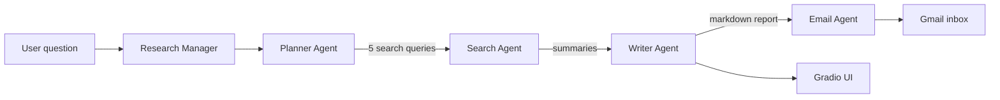

# Multi-Agent Deep Research

A multi-agent research pipeline. You type a question, and four specialized AI agents plan the searches, gather information from the web, write a structured report, and email it to you.

Built with Python, the OpenAI Agents SDK, the Gemini API, DuckDuckGo search, Pydantic and Gradio. It runs entirely on free-tier services.


## How it works



| Agent | Responsibility | Output |
|---|---|---|
| **Planner** | Breaks the question into 5 focused web searches, each with a reason | `WebSearchPlan` (Pydantic) |
| **Search** | Runs a web search with a DuckDuckGo tool and writes a short summary | Plain-text summary |
| **Writer** | Combines all summaries into a long, structured markdown report | `ReportData` (Pydantic) |
| **Email** | Converts the report to HTML and sends it through a tool call | Email via Gmail SMTP |

A `ResearchManager` class orchestrates the pipeline in plain Python. It calls each agent with `Runner.run()`, passes the output of one step to the next, and streams status updates to the UI.

## Design decisions

- **Orchestration in code, not by an LLM.** Each step is a separate `Runner.run()` call, so the flow is predictable, easy to debug and easy to test one agent at a time.
- **Structured outputs at every hand-off.** Pydantic models define what the Planner and Writer return, so downstream code never has to parse free text.
- **One agent, one job.** Each agent has a short, focused instruction set, which keeps prompts simple and makes each part replaceable.
- **Free-tier friendly.** Searches run one at a time with a short pause between them to stay within Gemini's free rate limits.
- **Swappable tools.** The search tool and the email sender are small functions, so another search provider or delivery channel can replace them without touching the agents.

## Tech stack

- **Language:** Python 3.11
- **Agent framework:** OpenAI Agents SDK, pointed at Gemini through its OpenAI-compatible endpoint
- **LLM:** Gemini API (model configurable through `.env`)
- **Web search:** DuckDuckGo via the `ddgs` package, exposed to the agent as a function tool
- **Schemas:** Pydantic
- **UI:** Gradio
- **Email:** Gmail SMTP with an app password

## Project structure

```
.
├── app.py                # Gradio UI
├── styles.py             # UI styling and example prompts
├── research_manager.py   # Orchestrates the four agents
├── planner_agent.py      # Plans the searches
├── search_agent.py       # Searches the web and summarizes
├── writer_agent.py       # Writes the final report
├── email_agent.py        # Sends the report by email
├── gemini_config.py      # Gemini client and model setup
├── messenger.py          # Email (and optional push) helpers
└── requirements.txt
```

## Getting started

### 1. Clone and install

```bash
git clone https://github.com/naveenkumar-analytics/Deep-Research-Agent.git
cd Deep-Research-Agent
pip install -r requirements.txt
```

Using `uv`: `uv add -r requirements.txt`

### 2. Configure environment variables

Create a `.env` file in the project root:

```
GOOGLE_API_KEY=your_gemini_api_key
DEFAULT_MODEL_NAME=gemini-2.5-flash
EMAIL_ADDRESS=you@gmail.com
EMAIL_SMTP_SERVER=smtp.gmail.com
EMAIL_APP_PASSWORD=your_gmail_app_password
USE_EMAIL=true
```

- Get a Gemini API key from [Google AI Studio](https://aistudio.google.com/).
- A Gmail app password requires 2-Step Verification on your Google account.
- Set `USE_EMAIL=false` to skip sending email and only see the report in the UI.
- Optional: `HOW_MANY_SEARCHES` (default `5`).

### 3. Run

```bash
python app.py
```

Open `http://127.0.0.1:7860`, type a question or pick an example, and click **Investigate**. Status updates appear first, then the full report. A run usually takes a few minutes because searches run one at a time.

## Example questions

- Most popular AI agent frameworks in 2026
- Competitors and pricing for wireless earbuds in India
- Recent developments in a technology or market you are researching

## Where this pattern can be useful

These are possible applications of the same pipeline. I have not measured results for them.

- Competitor and market research in e-commerce
- Client or company briefs before sales calls
- Weekly trend summaries sent to a team

Only the question changes; the agents and the flow stay the same.

## Limitations

- Agents read search **snippets**, not full web pages, so depth is limited.
- Reports are generated by an LLM and **can contain mistakes**. Important facts should be verified against the sources.
- The free Gemini tier has rate limits, so heavy use may return rate-limit errors.
- DuckDuckGo search can be rate-limited or blocked on some networks.
- The email is sent to the configured address only.

## Roadmap

- Fetch and read full pages for deeper research
- Include source links in the final report
- Retry and error handling around each search
- Human-in-the-loop approval before any email is sent
- Adapt the pipeline for research internship outreach

## Security

Never commit your `.env` file. It is listed in `.gitignore`. If a key is ever exposed, rotate it immediately.

## Acknowledgements

The base agent pattern comes from Ed Donner's Udemy course, *AI Engineer Agentic Track: The Complete Agent & MCP Course*. This version replaces the paid hosted search and OpenAI models with Gemini, a DuckDuckGo tool and Gmail SMTP, and adds a custom Gradio interface.

## Author

**Naveen Kumar**
GitHub: [naveenkumar-analytics](https://github.com/naveenkumar-analytics)
LinkedIn: [add your profile link]
